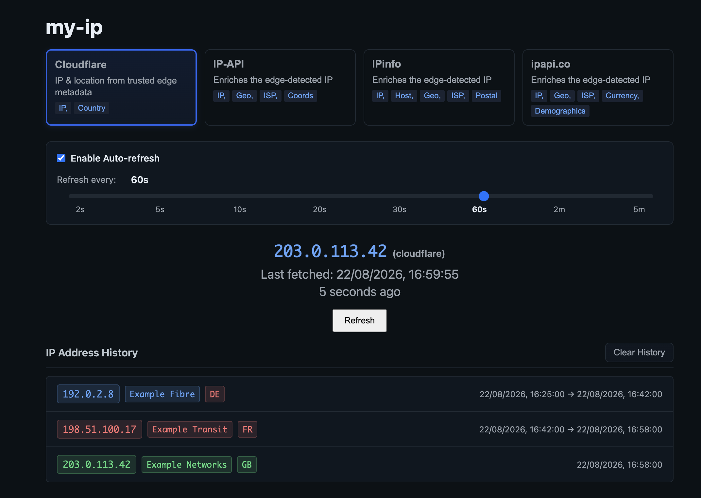

# my-ip

[](https://github.com/slpixe/my-ip/actions/workflows/deploy.yml)
[](LICENSE)

A privacy-conscious public IP viewer and history tracker, built with Next.js
and deployed to Cloudflare Workers.

[Open the live app](https://ip.slpixe.com)



_The screenshot uses deterministic [documentation-only IP ranges](https://www.rfc-editor.org/rfc/rfc5737) through a mocked Storybook state._

## Features

- Shows the visitor's public IP using trusted deployment-platform metadata.
- Adds optional country and ISP data through interchangeable provider adapters.
- Tracks IP changes and preferences in browser local storage only.
- Supports manual and configurable automatic refreshes.
- Applies distributed Cloudflare rate limiting, with a small in-memory fallback
  for local development and other runtimes.

## Engineering highlights

The browser calls `/api/ip?provider=...`. The API route validates the client IP
from Cloudflare request metadata or the Vercel deployment environment; request
headers cannot select their own trust path. It then rate-limits the lookup,
passes that explicit IP to a fixed provider URL, and returns a stable normalized
response instead of provider-specific payloads.

Per-visitor responses use private, no-store cache headers. Provider tokens remain
server-side, and the application does not persist IP history on the server.

## Technology

- Next.js 16, React 19, and TypeScript
- Cloudflare Workers through OpenNext
- Storybook, Vitest, Playwright, and accessibility checks
- GitHub Actions for validation and deployment

## Local development

Requires Node.js 24 or newer and pnpm 11.

```bash
pnpm install
pnpm dev
```

Open [http://localhost:3000](http://localhost:3000). No environment file is
required for normal development. To use an authenticated IPinfo lookup, copy
`.env.example` to `.env.local` and set `IPINFO_TOKEN`; local environment files
are ignored by Git.

In development, when trusted proxy metadata is unavailable, the API uses ipify
to discover the public IP. The local fallback rate limiter permits two requests
per two seconds per client key.

## Providers and privacy

- **Cloudflare** uses trusted edge IP and country metadata.
- **IP-API** enriches the detected IP; its free endpoint supports HTTP only.
- **IPinfo** supports an optional server-side `IPINFO_TOKEN`.
- **ipapi.co** provides location and ISP enrichment with a longer timeout.

Selecting an enrichment provider sends the visitor IP to that provider. Review
its terms and privacy policy before deploying your own instance. IP addresses
are personal data in many jurisdictions.

## Quality checks

```bash
pnpm lint
pnpm test
pnpm exec tsc --noEmit
pnpm build
pnpm build-storybook
```

The browser tests require Playwright Chromium, installed with
`pnpm exec playwright install chromium`.

For implementation details, see the [component architecture](docs/COMPONENT_ARCHITECTURE.md),
[context design](docs/contexts.md), [rate-limit test notes](docs/RATE_LIMITING_TEST.md),
and [Cloudflare deployment guide](CLOUDFLARE_DEPLOYMENT.md).

## License

MIT — see [LICENSE](LICENSE).
